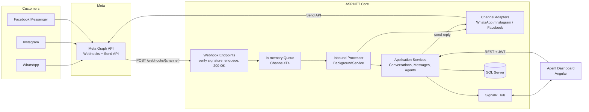
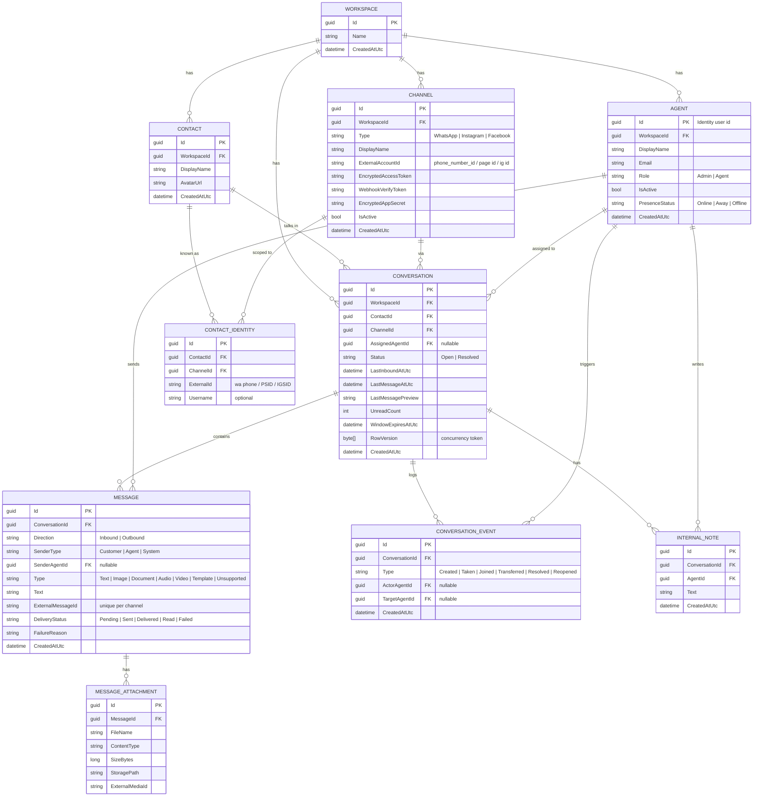
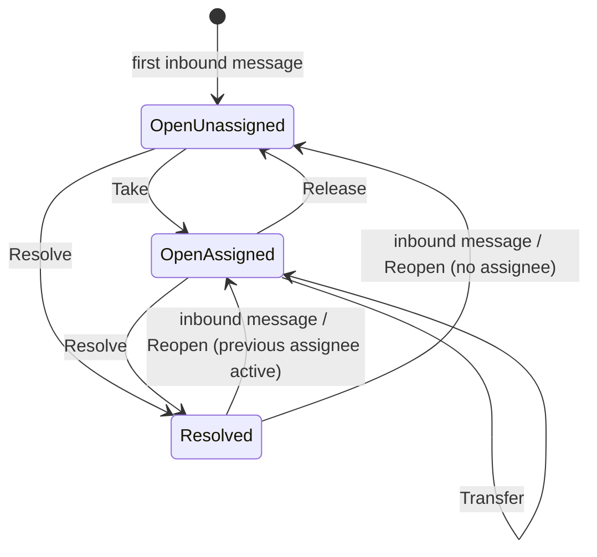
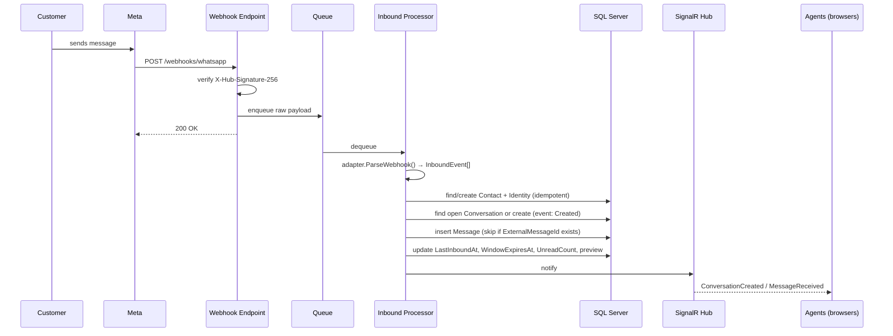
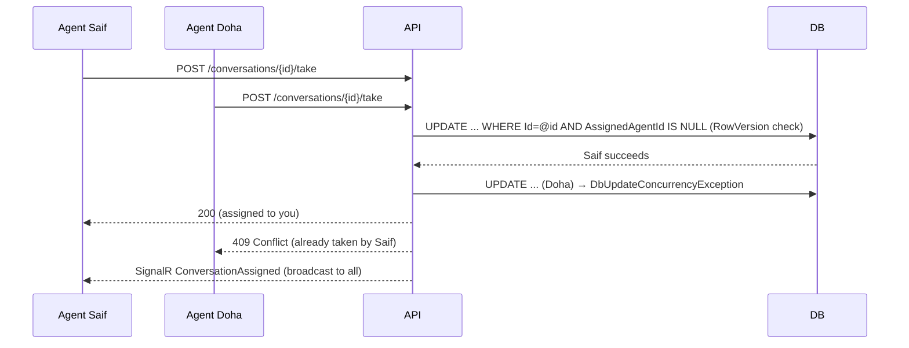

# Unified Inbox (Omnichannel Customer Support) — Full Project Spec

> Audience: an AI coding agent (OpenCode) and the developer (Sief).
> Goal: build an internal Crisp-like system where customer messages from WhatsApp, Instagram and Facebook Messenger arrive in ONE shared inbox, and company employees reply from named accounts.

---

## 1. Context

- Company: **Hilton** (flight ticket agency, office in Kuwait). Used only as seed data, **never hardcode "Hilton" in code or config**.
- Product type: **Internal tool, single company** (not SaaS). But the schema is **Workspace-ready** (see 4.1) so it can become multi-tenant later without a rewrite.
- Users: ~10 employees (agents) + 1 admin. Customers never log in; they talk to the company through WhatsApp / Instagram / Facebook.
- Developer profile: .NET backend developer (ASP.NET Core, C#, EF Core, Identity, concurrency). Familiar with Repository, Unit of Work, Specification, Result pattern, Onion/Clean Architecture. Learning Angular.

## 2. Functional Requirements

### 2.1 Accounts (no self-registration)

- There is **no public register endpoint**. Admin creates agent accounts (first name / display name, email, role).
- Agent receives a temporary password (or invite link), must change it on first login.
- Roles: `Admin`, `Agent`.
- First Admin is created by a database seeder from configuration (email/password from user-secrets / env vars).
- Admin can: create/disable agents, reset passwords, connect/disconnect channels, view all conversations.
- Agent can: see inbox, take conversations, reply, transfer, resolve/reopen, add internal notes.

### 2.2 Inbox (WhatsApp-like UI)

- **Left panel**: conversation list. Each item: customer name, channel icon (WhatsApp / Instagram / Facebook), last message preview, time, unread count, assigned agent name (or "Unassigned").
- **Right panel**: the chat. Header shows customer name, channel, and **the assigned agent**.
- Filters: All / Unassigned / Mine / Resolved; search by customer name or message text.
- Works on mobile browsers (responsive; PWA later).

### 2.3 Assignment & collaboration

- A new inbound conversation is **Unassigned** and shown to all online agents in real time.
- An agent presses **Take** → conversation becomes `Assigned` to them; header shows their name; others see "Taken by Saif".
- **Take must be race-safe**: if two agents press Take at the same time, exactly one succeeds, the other gets a clear "already taken by X" response (optimistic concurrency with `RowVersion`).
- **Any agent may open and reply in any conversation** (open model). Every outgoing message records the agent who sent it, and everyone sees the sender name on each message.
- When another agent sends a message in a conversation assigned to someone else, a system event is logged and shown ("Doha joined the conversation").
- **Presence & typing**: when an agent opens a conversation, other agents see "Doha is viewing"; while typing, "Doha is typing…". Purpose: reduce double replies.
- Transfer: assigned agent can transfer to another agent (system event logged).
- Resolve / Reopen. A new inbound message on a Resolved conversation reopens it (and goes back to the previous assignee, or Unassigned if they are disabled).
- The **customer never sees agent names** by default; they only talk to the company account. (Optional later: signature in message text.)

### 2.4 Channels

- WhatsApp (WhatsApp Business **Cloud API**), Instagram Messaging API, Facebook Messenger Platform — all via **Meta Graph API webhooks + send API**.
- Text first; then images/documents/audio.
- **24-hour window**: free-form replies are only allowed within 24h of the customer's last inbound message. Outside the window: WhatsApp requires an approved **template message**; Instagram/Messenger have restricted tags. UI must disable the composer and explain why when the window is closed.
- Delivery status for outbound messages: `Pending → Sent → Delivered → Read | Failed` (from Meta status webhooks).

### 2.5 After MVP (nice to have)

Canned replies, tags, internal notes, contact merge across channels, ticket/booking info linked to a contact, reports (response time, per-agent load), auto-assignment (round robin), push notifications, business hours + auto-reply.

## 3. Non-Functional Requirements

- Webhooks respond **HTTP 200 within a few seconds**; heavy work is done asynchronously (in-process queue + hosted service).
- Webhook processing is **idempotent** (Meta retries). Unique index on `(ChannelId, ExternalMessageId)`.
- Verify the Meta signature (`X-Hub-Signature-256`, HMAC-SHA256 with App Secret) on every POST webhook; verify the GET challenge with the verify token.
- Channel access tokens are **encrypted at rest** (ASP.NET Core Data Protection) and never logged or returned by the API.
- Webhooks need a **public HTTPS URL** (dev: ngrok / Cloudflare Tunnel).
- Structured logging (Serilog), correlation id per webhook.
- All times stored in **UTC**.
- Meta API version is **configurable** (appsettings), not hardcoded. The agent must check current Meta docs for payload shapes and endpoints.

## 4. Architecture

### 4.1 Tech stack

| Layer | Choice |
|---|---|
| Runtime | .NET 8 (LTS) or newer |
| API | ASP.NET Core Web API (controllers or minimal APIs, choose controllers) |
| Real time | SignalR |
| Auth | ASP.NET Core Identity + JWT (access token) + refresh token |
| DB | SQL Server + EF Core (Code First migrations) |
| Background | `BackgroundService` + `System.Threading.Channels` |
| Logging | Serilog |
| Validation | FluentValidation |
| Mapping | Mapperly or manual mapping (no heavy magic) |
| Tests | xUnit, FluentAssertions, Testcontainers (SQL Server) for integration tests |
| Frontend | Angular (standalone components, SignalR client `@microsoft/signalr`) — built AFTER the backend MVP |

Patterns: Clean/Onion Architecture, Result pattern (no exceptions for business failures), Repository + Unit of Work only where it adds value (EF Core's DbContext is already a UoW — keep repositories thin or use Specification for complex queries). CQRS-lite with MediatR is optional; prefer simple application services.

### 4.2 Solution structure

```
src/
  Inbox.Domain/            # entities, enums, domain events, Result type (no dependencies)
  Inbox.Application/       # use cases/services, DTOs, interfaces (IChannelAdapter, IInboxNotifier...), validators
  Inbox.Infrastructure/    # EF Core, Identity, Meta adapters, token encryption, email, background queue
  Inbox.Api/               # controllers, webhooks endpoints, SignalR hubs, auth config, DI, Program.cs
tests/
  Inbox.Domain.Tests/
  Inbox.Application.Tests/
  Inbox.IntegrationTests/
docs/
  unified-inbox-spec.md    # this file
```

### 4.3 System diagram



### 4.4 Channel Adapter pattern

Each channel implements one interface. Everything above it is channel-agnostic.

```csharp
public interface IChannelAdapter
{
    ChannelType Type { get; }

    // Webhook side
    bool VerifySignature(string rawBody, string signatureHeader, Channel channel);
    IReadOnlyList<InboundEvent> ParseWebhook(string rawBody);   // messages + status updates, normalized

    // Send side
    Task<SendResult> SendTextAsync(Channel channel, string recipientExternalId, string text, CancellationToken ct);
    Task<SendResult> SendMediaAsync(Channel channel, string recipientExternalId, OutboundMedia media, CancellationToken ct);
    Task<SendResult> SendTemplateAsync(Channel channel, string recipientExternalId, TemplateMessage template, CancellationToken ct); // WhatsApp
}
```

`InboundEvent` is a normalized record: `ChannelType`, `ExternalContactId`, `ContactDisplayName?`, `ExternalMessageId`, `Kind` (Message | StatusUpdate), `Text?`, `Media?`, `Timestamp`, `Status?`.
An `IChannelAdapterFactory` resolves the adapter by `ChannelType`. Adding Telegram later = one new adapter class.

## 5. Domain Model

### 5.1 ERD



### 5.2 Indexes & constraints (must-have)

- `ContactIdentity`: unique `(ChannelId, ExternalId)`.
- `Message`: unique filtered index `(ConversationId, ExternalMessageId)` where `ExternalMessageId IS NOT NULL`; also a lookup index on `ExternalMessageId` (for status webhooks).
- `Conversation`: index `(WorkspaceId, Status, LastMessageAtUtc DESC)`; index `(AssignedAgentId, Status)`; one **active (Open) conversation per (ContactId, ChannelId)** (filtered unique index where `Status = 'Open'`).
- `Conversation.RowVersion` configured as `IsRowVersion()`.
- Enums stored as strings.
- Soft-disable agents (`IsActive = false`), never hard-delete (messages reference them).

### 5.3 Conversation lifecycle



## 6. Key Flows

### 6.1 Inbound message



### 6.2 Take (race-safe)



Implementation note: load conversation, check `AssignedAgentId == null`, set it, `SaveChanges`. Catch `DbUpdateConcurrencyException` → reload → return `Result.Failure(AlreadyTaken(agentName))`.

### 6.3 Outbound reply

1. Agent `POST /conversations/{id}/messages` with text.
2. Validate: conversation exists, channel active, **24h window open** (else 422 `WindowClosed`).
3. Insert `Message` (`Outbound`, `SenderAgentId = current agent`, `DeliveryStatus = Pending`).
4. If the sender is not the assignee: add `ConversationEvent(Joined)` once per agent per conversation.
5. Broadcast `MessageReceived` (own echo) via SignalR immediately (optimistic UI).
6. Adapter sends via Meta; save `ExternalMessageId`, status `Sent` (or `Failed` + reason). Broadcast `MessageStatusUpdated`.
7. Meta status webhooks later update `Delivered` / `Read`.

## 7. API Surface (REST)

All endpoints require JWT unless noted. Base path `/api`. Responses use a consistent problem-details format for errors.

### Auth

- `POST /auth/login` (anonymous) → `{accessToken, refreshToken, agent}`
- `POST /auth/refresh` (anonymous)
- `POST /auth/change-password`
- `POST /auth/logout`

### Agents (Admin only, except `me`)

- `GET /agents/me`
- `GET /agents` (Admin; Agents also need a basic list for transfer → return minimal fields)
- `POST /agents` (Admin) — create agent, returns temporary password once
- `PUT /agents/{id}` — name / role
- `POST /agents/{id}/deactivate` / `activate`
- `POST /agents/{id}/reset-password`
- `PUT /agents/me/presence`

### Channels (Admin)

- `GET /channels`, `POST /channels`, `PUT /channels/{id}`, `DELETE /channels/{id}` (deactivate)
- Tokens are write-only (never returned).

### Conversations

- `GET /conversations?filter=all|unassigned|mine|resolved&channel=&search=&cursor=&pageSize=` (cursor pagination)
- `GET /conversations/{id}`
- `GET /conversations/{id}/messages?before=&pageSize=`
- `POST /conversations/{id}/take`
- `POST /conversations/{id}/release`
- `POST /conversations/{id}/transfer` `{targetAgentId}`
- `POST /conversations/{id}/resolve` / `reopen`
- `POST /conversations/{id}/read` (reset unread)
- `POST /conversations/{id}/messages` `{text}` (later: multipart for media; template send)
- `GET/POST /conversations/{id}/notes` (post-MVP)

### Webhooks (anonymous, signature-protected)

- `GET  /webhooks/whatsapp` | `POST /webhooks/whatsapp`
- `GET  /webhooks/instagram` | `POST /webhooks/instagram`
- `GET  /webhooks/facebook` | `POST /webhooks/facebook`
- Resolve the `Channel` row by the external account id in the payload to get the right secret.

## 8. SignalR

Hub: `/hubs/inbox` (JWT via query string `access_token` for WebSockets).

**Audiences**: every connection of a workspace sees workspace events; a thread's events go only to the
connections that currently have that thread open. Implemented with an in-memory connection registry
(`InboxConnectionRegistry`) that maps connection → workspace, and conversation → open connections, and
sends with `IHubClients.Clients(connectionIds)`.

**Implementation deviation — groups replaced by a connection registry.** The design above calls for
SignalR groups (`workspace:{workspaceId}`, `conversation:{id}`). Under the in-memory
`TestServer` used by the integration tests, `DefaultHubLifetimeManager` accepts
`Groups.AddToGroupAsync` without error but keeps zero group memberships, so every `Clients.Group(...)`
send is dropped while `Clients.Caller(...)` and `Clients(connectionIds)` deliver normally. The registry
reproduces the two audiences exactly and is verifiable end to end today; a backplane such as Redis
will be needed before more than one API instance can serve the same dashboard.

**Server → client events**

| Event | Payload | Sent to |
|---|---|---|
| `ConversationCreated` | conversation summary | workspace |
| `ConversationUpdated` | summary (preview, unread, status) | workspace |
| `ConversationAssigned` | `{conversationId, agentId, agentName}` | workspace |
| `MessageReceived` | message DTO (carries its `conversationId`) | thread viewers + workspace summary update |
| `MessageStatusUpdated` | `{messageId, status}` | thread viewers |
| `AgentViewing` / `AgentLeft` | `{conversationId, agentId, agentName}` | thread viewers |
| `AgentTyping` | `{conversationId, agentId, agentName}` | other thread viewers |
| `AgentPresenceChanged` | `{agentId, status}` | workspace |

**Client → server methods**: `OpenConversation(id)`, `CloseConversation(id)`, `Typing(id)`.
Viewers are tracked in a thread-safe in-memory store (`ConcurrentDictionary`) keyed by conversation, cleaned up on disconnect. (Single server instance assumed; Redis backplane is a later concern.)

## 9. Security Checklist

- No register endpoint; lockout enabled; password policy enforced; forced change on first login.
- JWT short-lived (15 min) + refresh token (rotated, stored hashed).
- Authorization policies: `AdminOnly`, `AgentOrAdmin`.
- Webhook signature verification mandatory; reject on mismatch with 401 and log.
- Encrypt channel tokens/secrets with Data Protection; never log tokens or full payloads containing PII at Information level.
- CORS limited to the Angular origin.
- Rate limiting on login and webhooks.
- Validate and size-limit uploads; store outside web root; whitelist content types.
- Secrets via user-secrets (dev) / environment variables or a vault (prod).

## 10. Implementation Phases (do them in order, each ends with a working, tested state)

### Phase 0 — Skeleton

- Create solution, 4 projects + test projects, references following dependency rule (Domain ← Application ← Infrastructure/Api).
- Serilog, health check endpoint, Swagger, global exception handler → ProblemDetails, Result type.
- **Done when**: solution builds, `/health` returns 200, CI-ready `dotnet test` runs.

### Phase 1 — Data & Auth

- Entities, EF configurations (Fluent API), initial migration, seeder (Workspace "Default" name from config, first Admin).
- Identity with `Agent` extending `IdentityUser<Guid>`; JWT + refresh tokens; login/refresh/change-password; Admin create/deactivate agent; no register endpoint.
- **Done when**: Admin can log in, create an agent, agent logs in and is forced to change password; integration tests pass.

### Phase 2 — Conversations core (no Meta yet)

- Fake channel (`ChannelType.Test`) + dev-only endpoint `POST /dev/simulate-inbound` to inject inbound messages.
- Inbound processor with queue, contact/conversation/message creation, idempotency.
- Conversation list/detail/messages endpoints, take/release/transfer/resolve/reopen, events, **RowVersion concurrency test** (two parallel takes → one 200, one 409).
- Outbound send via a fake adapter.
- **Done when**: full flow works through the simulator and integration tests cover take-race and idempotency.

**Status: done.** Decisions taken while building it:

- The simulator is mapped at `/api/dev/simulate-inbound` (the `/api` prefix matches every other endpoint), is removed from MVC outside Development by `DevOnlyControllerFeatureProvider`, and requires an admin token.
- It answers `202 Accepted` once queued; `InboundProcessorWorker` stores the message. The queue is an in-memory bounded `Channel` with `DropOldest`, so a burst can never block the caller.
- Idempotency is enforced by the unique index on `(ChannelId, ExternalMessageId)`, with a pre-check and one retry; the pre-check alone would not survive two workers racing.
- Taking a conversation you already own returns `200` (the UI fires it from two places); taking one owned by anyone else returns `409 conversation.already_taken` — **including for admins**, who use `transfer` so the event history never pretends nobody was working on it.
- `resolve` keeps the assignee so `reopen` hands the thread back; reopening releases it if the owner has been deactivated.
- A new inbound message on a resolved conversation reopens that thread rather than opening a second one.
- Outbound replies are stored before the adapter is called and only allowed inside the 24-hour window; `TestChannelAdapter` fails on demand when the text starts with `/fail`.
- `WebApplicationFactory` never calls `IHost.StartAsync`, so `ApiFactory` starts the hosted services itself — otherwise the queue worker never runs and the async path cannot be tested.

### Phase 3 — SignalR

- Hub, groups, all events from section 8, viewing/typing, presence.
- **Done when**: two browser tabs / test clients see assignment, new messages and viewing/typing in real time.

**Status: done.** Decisions taken while building it:

- **Groups were replaced by a connection registry** (see the deviation note in section 8): group membership does not survive in the in-memory test host, so the audiences are resolved to connection ids and sent with `Clients(connectionIds)`. Behaviour is unchanged; the transport is.
- `InboxNotifier` is the publish port in Application; `SignalRInboxNotifier` is the adapter registered by the Api host, so Application and Infrastructure stay unaware of SignalR.
- Events carry the workspace id as a parameter instead of resolving it per call, because one action usually raises several events (a new message updates the list row and the open thread).
- Every announcement costs one extra read to rebuild the denormalised list row (contact name, channel, owner, window state) that only a query can produce. A client that misses an event just refetches, so delivery is best-effort by design.
- `ConversationMessageResponse` gained `ConversationId`, because the same DTO is the payload of `MessageReceived` and the client has to know which thread it belongs to.
- `SendMessage` raises `MessageReceived` for the thread viewers and a list update for the workspace; `MarkRead` announces too, because `ExecuteUpdate` bypasses the change tracker.
- Inbound messages raise `MessageReceived` only. `MessageStatusUpdated` describes outbound delivery, not an inbound arrival.
- The token is read from `?access_token=` for the hub path only; every other route still requires the `Authorization` header.
- Covered by 11 integration tests in `LiveUpdateTests`: per-thread isolation, assignment, list updates, viewing/typing, presence, disconnect cleanup, and rejecting an anonymous connection.

### Phase 4 — WhatsApp (real)

- GET verify + POST webhook with signature check, WhatsApp adapter (parse text + statuses, send text), 24h window enforcement, status updates (Sent/Delivered/Read/Failed), template message sending.
- Document local setup with a tunnel (ngrok / Cloudflare) in README.
- **Done when**: a real WhatsApp test number can chat with the dashboard both ways.

### Phase 5 — Instagram & Facebook

- Two more adapters implementing `IChannelAdapter`; no changes to Application/Domain beyond config.
- **Done when**: both channels chat end-to-end.

### Phase 6 — Media

- Receive/download media from Meta, store files, attachments in messages; send images/documents. Size and type limits.

### Phase 7 — Angular dashboard

- Login, inbox (left list + right chat), filters, search, take/transfer/resolve, live updates through SignalR, viewing/typing indicators, admin pages (agents, channels), responsive layout for mobile.

### Phase 8 — Polish

- Canned replies, internal notes, tags, unread/notification sounds, basic reports, auto-assignment, business hours auto-reply, Docker + deployment guide.

## 11. Testing Strategy

- **Domain/Application unit tests**: conversation state transitions, window calculation, assignment rules.
- **Integration tests** (WebApplicationFactory + Testcontainers SQL Server): auth flow, take race condition, webhook idempotency (same payload twice → one message), signature rejection, outbound window enforcement.
- **Adapter tests**: feed recorded sample Meta payloads (stored under `tests/Fixtures/`) and assert normalized `InboundEvent`s.

`dotnet test` runs everything. The integration tests start a throwaway SQL Server container through
Testcontainers, so they need a running Docker daemon and pull `mcr.microsoft.com/mssql/server:2022-latest`
on first run. One container is shared by the whole suite, so the tests run serially: Identity's lockout
counters are per account, and parallel logins against the same account would trip them.

## 12. Configuration (appsettings / env)

```json
{
  "ConnectionStrings": { "Default": "..." },
  "Jwt": { "Issuer": "", "Audience": "", "SigningKey": "", "AccessTokenMinutes": 15 },
  "Seed": { "WorkspaceName": "", "AdminEmail": "", "AdminDisplayName": "", "AdminPassword": "" },
  "Meta": { "GraphApiVersion": "<set from current Meta docs>", "GraphBaseUrl": "https://graph.facebook.com" },
  "Cors": { "AllowedOrigins": [ "http://localhost:4200" ] },
  "Storage": { "RootPath": "" },
  "RateLimiting": {
    "LoginPermitLimit": 30,
    "LoginWindowSeconds": 60,
    "RefreshPermitLimit": 60,
    "RefreshWindowSeconds": 60,
    "WebhookPermitLimit": 600,
    "WebhookWindowSeconds": 60
  }
}
```

The rate limits are per IP because the limiter runs before the request body is read, so the account is
not known yet. When the whole office shares one public IP, raise `LoginPermitLimit`; brute-force
protection is the Identity lockout (5 failures, then 15 minutes), not the per-IP counter.

No real secrets committed. Provide `appsettings.Development.json.example`.

## 13. Meta Setup Notes (for the developer, not the agent)

1. Create a Meta Developer app + Meta Business account; start **Business Verification** early (can take time).
2. WhatsApp: add the WhatsApp product, register a dedicated phone number (not already used on the normal WhatsApp app), get `phone_number_id` and a permanent system-user token.
3. Facebook/Instagram: connect a Facebook Page and the Instagram professional account; request `pages_messaging`, `instagram_manage_messages` (App Review is needed for production use with real customers; for internal use with the app owner's own accounts, development mode may be enough — verify in Meta docs).
4. Configure webhook callback URLs and verify tokens per product.
5. Prepare WhatsApp **message templates** (e.g., booking confirmation, follow-up) for conversations outside the 24h window.

## 14. Rules for the Coding Agent

1. Work **phase by phase**. Finish and test a phase before starting the next. After each phase, summarize what was done and what's next.
2. Follow the dependency rule strictly: Domain has no dependencies; Application depends on Domain only; Infrastructure implements Application interfaces.
3. Business failures return `Result`, not exceptions. Exceptions are for unexpected errors.
4. Never hardcode company names, tokens, or URLs. Everything via configuration.
5. Every conversation-mutating operation must respect `RowVersion` concurrency.
6. Webhook handlers must be idempotent and fast; no heavy work before returning 200.
7. Do not invent Meta payload formats or endpoint paths from memory: **consult current Meta documentation** and keep sample payloads as test fixtures. If something is ambiguous, ask instead of guessing.
8. Write tests alongside code (see section 11). Keep commits small and meaningful.
9. If a requirement here conflicts with a technical reality, stop and explain the trade-off before deviating.
10. Do not build Phase 7+ (Angular and beyond) until the developer explicitly says to start it.